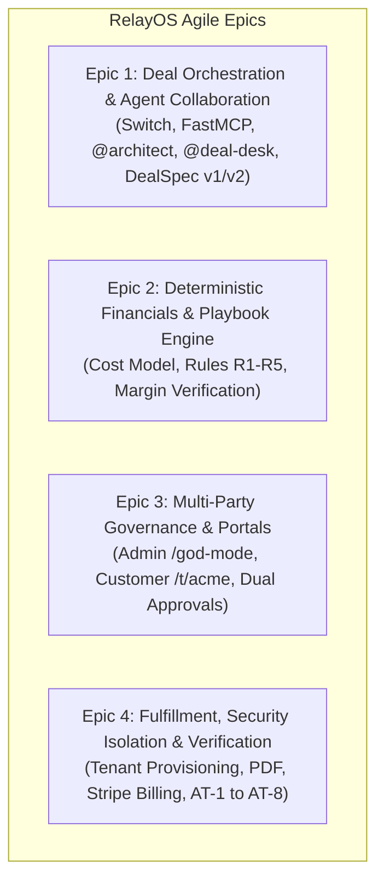
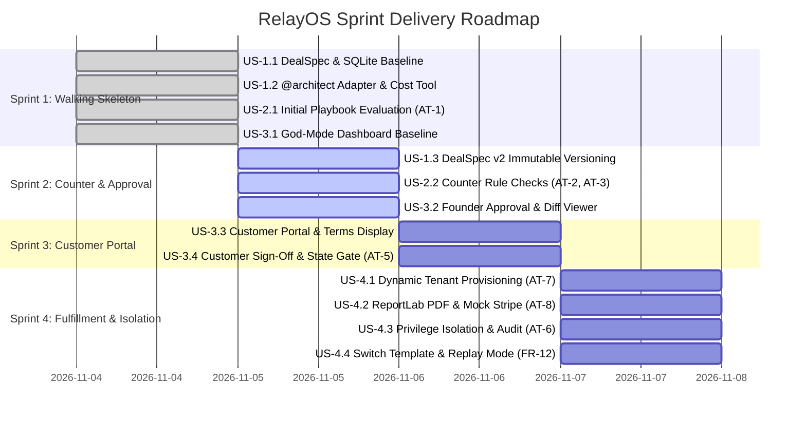

# RelayOS — Agile Product Backlog & User Story Mapping (BACKLOG.md)

**Project:** RelayOS — Autonomous Enterprise Deal Closing Platform  
**Hackathon:** Flip the Switch (Track 01 — Best Business Workflow)  
**Date:** November 4, 2026  
**Status:** Approved Product Backlog  

---

## 1. Epics & Themes Overview

The RelayOS solution is structured across four primary business epics:

---

## 2. Sprint Roadmap: Vertical Slices (Walking Skeletons)

Rather than building layer-by-layer (horizontal architecture), all stories are organized into **four Vertical Slices (Sprints)**. Each slice delivers an end-to-end user-facing capability cutting across DB, Backend, Agents, and Frontend.

---

## 3. Detailed User Stories & Acceptance Criteria

---

### Sprint 1 (Slice 1): The Walking Skeleton — The Failing Deal Loop

#### **User Story US-1.1: DealSpec & State Store Baseline**
* **Priority**: P0 (Must Have)
* **Estimation**: 3 Story Points
* **User Story**:  
  *As a* systems developer,  
  *I want* a strictly typed Pydantic DealSpec schema backed by an SQLite persistence store,  
  *so that* agents and backend services communicate using a single, tamper-proof contract.
* **Acceptance Criteria (Given-When-Then)**:
  - **Given** an initial customer request payload,
  - **When** the backend initializes the deal,
  - **Then** a DealSpec record is persisted in `deal_specs` at `version = 1` and `state = DRAFT`.

#### **User Story US-1.2: `@architect` Adapter Generation & Cost Model**
* **Priority**: P0 (Must Have)
* **Estimation**: 5 Story Points
* **User Story**:  
  *As the* Founder,  
  *I want* `@architect` to build a custom ERP adapter in `./relayos-app`, run tests, and compute the infrastructure cost,  
  *so that* engineering feasibility and dedicated hosting costs are established deterministically.
* **Acceptance Criteria (Given-When-Then) [AT-4]**:
  - **Given** an allocated rate limit of 1,000 RPM,
  - **When** `@architect` invokes `estimate_cost`,
  - **Then** the tool returns exactly $\$8,000$ every single run without variance ($\$1,000 + \$7 \times 1,000$), advances state to `ENGINEERED`, and verifies that adapter tests pass in pytest.

#### **User Story US-2.1: Deterministic Playbook Evaluation (Failing Ask)**
* **Priority**: P0 (Must Have)
* **Estimation**: 5 Story Points
* **User Story**:  
  *As the* `@deal-desk` agent,  
  *I want* to evaluate DealSpec v1 against the company pricing playbook rules (R1–R5),  
  *so that* unprofitable deals are flagged immediately before any commitment is made.
* **Acceptance Criteria (Given-When-Then) [AT-1]**:
  - **Given** DealSpec v1 at $\$20,000$ annual price and $1,000$ RPM (cost $\$8,000$),
  - **When** `check_playbook` executes,
  - **Then** gross margin is computed as exactly $60.0\%$, the verdict is `fail`, and the response explicitly cites rule failures for `R1` (margin $<75\%$) and `R2` (discount $16.7\% > 10\%$).

#### **User Story US-3.1: Admin Dashboard Baseline (`/god-mode`)**
* **Priority**: P1 (High Value)
* **Estimation**: 5 Story Points
* **User Story**:  
  *As the* Founder,  
  *I want* to view live deal telemetry at `/god-mode`,  
  *so that* I can visually monitor the DealSpec, test results, and margin status in real time.
* **Acceptance Criteria (Given-When-Then)**:
  - **Given** DealSpec v1 in state `PRICE_CHECKED`,
  - **When** I load `/god-mode`,
  - **Then** the interface displays a **Red Margin Bar** at $60.0\%$, displays the git diff and passing test status from `./relayos-app`, and lists recent audit log entries.

---

### Sprint 2 (Slice 2): The Negotiation & Margin Counter Loop

#### **User Story US-1.3: Immutable DealSpec Versioning (v1 $\rightarrow$ v2)**
* **Priority**: P0 (Must Have)
* **Estimation**: 3 Story Points
* **User Story**:  
  *As a* compliance auditor,  
  *I want* counter-proposals to create an incremented, immutable DealSpec version,  
  *so that* past negotiation terms are never overwritten or erased.
* **Acceptance Criteria (Given-When-Then)**:
  - **Given** DealSpec v1,
  - **When** the Founder issues counter-terms ($600$ RPM, $\$22,000$/yr, Net-15, waived setup fee),
  - **Then** the database inserts a distinct record `version = 2` without modifying `version = 1`.

#### **User Story US-2.2: Counter-Offer Rule Verification**
* **Priority**: P0 (Must Have)
* **Estimation**: 5 Story Points
* **User Story**:  
  *As the* `@deal-desk` agent,  
  *I want* to verify that intermediate offers fail and the Founder's counter passes all playbook rules,  
  *so that* only compliant offers can be approved.
* **Acceptance Criteria (Given-When-Then) [AT-2, AT-3]**:
  - **Given** intermediate offers of $\$22\text{k} / 1\text{k RPM}$ and $\$20\text{k} / 600\text{ RPM}$,  
    **When** `check_playbook` runs,  
    **Then** both fail rule R1 at $63.6\%$ and $74.0\%$ margin respectively [AT-2].
  - **Given** Founder counter-terms of $\$22,000$/yr, $600$ RPM, Net-15, waived setup fee, and white-labeling,  
    **When** `check_playbook` runs,  
    **Then** gross margin is computed as $76.4\%$, and rules `R1` through `R5` all return `pass` [AT-3].

#### **User Story US-3.2: Founder Approval & Version Diffing in God-Mode**
* **Priority**: P1 (High Value)
* **Estimation**: 5 Story Points
* **User Story**:  
  *As the* Founder,  
  *I want* to view a side-by-side diff between v1 and v2 and click "Approve Proposal",  
  *so that* commercial counter-terms are formally signed off.
* **Acceptance Criteria (Given-When-Then)**:
  - **Given** DealSpec v2 passing all playbook checks,
  - **When** I click "Approve Proposal" in `/god-mode`,
  - **Then** the margin bar turns **Green** ($76.4\%$), the deal state transitions to `FOUNDER_APPROVED`, and the approval event is recorded in `audit_logs`.

---

### Sprint 3 (Slice 3): The Customer Enterprise Portal & Sign-off Loop

#### **User Story US-3.3: Customer Proposal Display (`/t/acme`)**
* **Priority**: P0 (Must Have)
* **Estimation**: 5 Story Points
* **User Story**:  
  *As the* Acme Champion,  
  *I want* to view our customized enterprise proposal at `/t/acme`,  
  *so that* I can evaluate price, term, rate limit, and commercial conditions.
* **Acceptance Criteria (Given-When-Then)**:
  - **Given** a deal in state `FOUNDER_APPROVED`,
  - **When** the customer visits `/t/acme`,
  - **Then** the page renders Acme branding, $\$22,000$/yr, $600$ RPM, Net-15, waived setup fee, and **completely redacts** internal costs and margins.

#### **User Story US-3.4: Customer Acceptance & Transition Gate Enforcement**
* **Priority**: P0 (Must Have)
* **Estimation**: 5 Story Points
* **User Story**:  
  *As the* Acme Champion,  
  *I want* to accept or reject the proposal with an authenticated signature action,  
  *so that* the deal can advance to provisioning.
* **Acceptance Criteria (Given-When-Then) [AT-5]**:
  - **Given** a proposal in `FOUNDER_APPROVED`,  
    **When** the customer clicks "Accept Offer",  
    **Then** the deal state transitions to `CUSTOMER_ACCEPTED`, recording the customer's identity and timestamp.
  - **Given** a deal in any state prior to `CUSTOMER_ACCEPTED` (`DRAFT`, `ENGINEERED`, `PRICE_CHECKED`, `FOUNDER_APPROVED`),  
    **When** any actor attempts to invoke `provision_tenant`, `render_order_form`, or `create_invoice`,  
    **Then** the backend rejects the request with an HTTP 400/403 state error, and zero tenant or invoice is generated [AT-5].

---

### Sprint 4 (Slice 4): Fulfillment, Privilege Isolation & Telemetry

#### **User Story US-4.1: Dynamic Tenant Provisioning & Rate Limiter**
* **Priority**: P0 (Must Have)
* **Estimation**: 5 Story Points
* **User Story**:  
  *As the* `@deal-desk` agent,  
  *I want* to provision the customer's dedicated tenant at `/t/acme` with an active rate limiter,  
  *so that* the live enterprise environment is deployed immediately upon deal closing.
* **Acceptance Criteria (Given-When-Then) [AT-7]**:
  - **Given** DealSpec v2 in state `CUSTOMER_ACCEPTED` with $600$ RPM quota,
  - **When** `provision_tenant` is executed,
  - **Then** the tenant is activated, and sending $601$ requests in 60s returns HTTP 429 on the 601st request, while querying an unknown tenant returns HTTP 404.

#### **User Story US-4.2: Legal Order Form PDF & Mock Stripe Invoicing**
* **Priority**: P0 (Must Have)
* **Estimation**: 5 Story Points
* **User Story**:  
  *As the* `@deal-desk` agent,  
  *I want* to generate an Order Form PDF and a mock Stripe invoice,  
  *so that* legally binding order documents and payment links are ready instantly.
* **Acceptance Criteria (Given-When-Then) [AT-8]**:
  - **Given** DealSpec v2 in state `PROVISIONED`,
  - **When** `render_order_form` and `create_invoice` are executed,
  - **Then** a ReportLab PDF is generated and a Stripe mock invoice is issued, with price ($22k), term (12 mo), rate limit ($600$ RPM), Net-15, and waived fee matching DealSpec v2 exactly.

#### **User Story US-4.3: Privilege Isolation & Audit Log Verification**
* **Priority**: P0 (Must Have)
* **Estimation**: 5 Story Points
* **User Story**:  
  *As a* security engineer,  
  *I want* tool permissions strictly partitioned between agents and unauthorized actions audited,  
  *so that* compromised or hallucinating agents cannot execute billing actions.
* **Acceptance Criteria (Given-When-Then) [AT-6]**:
  - **Given** the `@architect` agent tool configuration,
  - **When** `@architect` attempts to invoke `create_invoice`,
  - **Then** the call is denied with HTTP 403, and an `UNAUTHORIZED_ACCESS_DENIED` entry is recorded in `audit_logs` and highlighted in `/god-mode`.

#### **User Story US-4.4: Switch Room Template & Offline Replay Mode**
* **Priority**: P1 (High Value)
* **Estimation**: 5 Story Points
* **User Story**:  
  *As a* hackathon judge,  
  *I want* a declarative Switch room template and an offline Replay Mode,  
  *so that* I can evaluate the complete workflow on a clean machine without external API keys.
* **Acceptance Criteria (Given-When-Then) [FR-12]**:
  - **Given** a fresh clone without an agent API key,
  - **When** I run `./scripts/demo_up.sh --replay`,
  - **Then** recorded agent transcripts drive the exact same backend tools, UI state, and audit logs deterministically.

---

## 4. Definition of Done (DoD)

A User Story is considered **DONE** only when:
1. **Unit & Contract Tests**: All associated automated unit and acceptance tests (AT-1 through AT-8) pass with 100% green status.
2. **Schema Compliance**: Pydantic models validate input and output payloads without truncation or unexpected defaults.
3. **Audit Trail**: Every significant action or state transition produces a persistent entry in `audit_logs`.
4. **UI Integration**: Frontend views render the new state cleanly without console errors or layout breakage.
5. **Security Gates Verified**: Unauthorized endpoints or early transitions are rejected with proper HTTP 400/403 status codes.
6. **Code Quality**: Code is modular, documented, linted, and runs cleanly under Python 3.11 with `uv`.

---

## 5. Summary Backlog Matrix

| Story ID | Epic | Title | Sprint | Priority | Points | Acceptance Test |
| :---: | :---: | :--- | :---: | :---: | :---: | :---: |
| **US-1.1** | Epic 1 | DealSpec & State Store Baseline | Sprint 1 | P0 | 3 | — |
| **US-1.2** | Epic 1 | `@architect` Adapter & Cost Model | Sprint 1 | P0 | 5 | **AT-4** |
| **US-2.1** | Epic 2 | Deterministic Playbook Check (Fail) | Sprint 1 | P0 | 5 | **AT-1** |
| **US-3.1** | Epic 3 | God-Mode Admin Dashboard Baseline | Sprint 1 | P1 | 5 | — |
| **US-1.3** | Epic 1 | Immutable DealSpec Versioning (v1 $\rightarrow$ v2) | Sprint 2 | P0 | 3 | — |
| **US-2.2** | Epic 2 | Counter-Offer Rules (R1–R5 Pass) | Sprint 2 | P0 | 5 | **AT-2, AT-3** |
| **US-3.2** | Epic 3 | Founder Approval & Diff in God-Mode | Sprint 2 | P1 | 5 | — |
| **US-3.3** | Epic 3 | Customer Proposal Display (`/t/acme`) | Sprint 3 | P0 | 5 | — |
| **US-3.4** | Epic 3 | Customer Acceptance & Transition Gate | Sprint 3 | P0 | 5 | **AT-5** |
| **US-4.1** | Epic 4 | Dynamic Tenant Provisioning & Limiter | Sprint 4 | P0 | 5 | **AT-7** |
| **US-4.2** | Epic 4 | ReportLab PDF & Mock Stripe Invoice | Sprint 4 | P0 | 5 | **AT-8** |
| **US-4.3** | Epic 4 | Privilege Isolation & Audit Log | Sprint 4 | P0 | 5 | **AT-6** |
| **US-4.4** | Epic 4 | Switch Template & Replay Mode | Sprint 4 | P1 | 5 | FR-12 |

**Total Scope**: 13 User Stories across 4 Vertical Slices (Sprints), covering 100% of P0/P1 requirements and all 8 Acceptance Tests.
