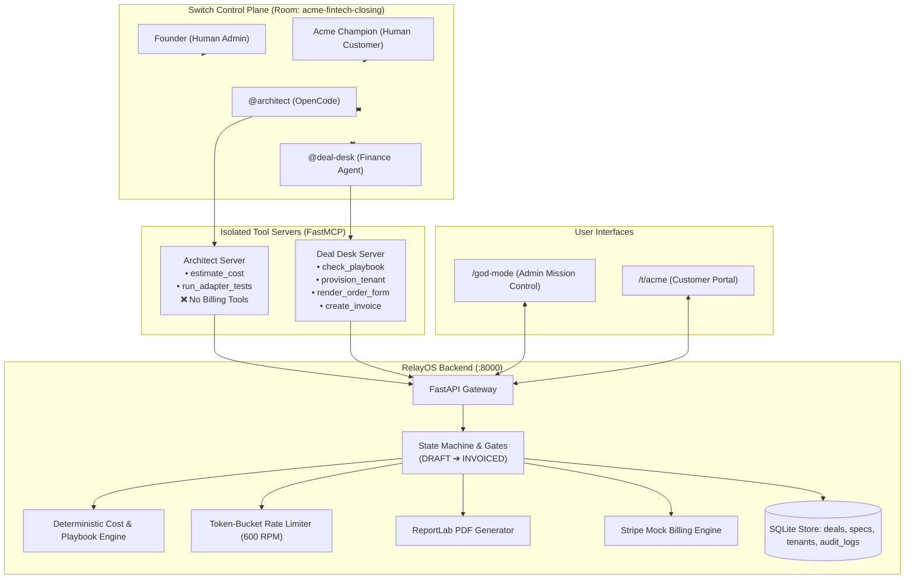

# RelayOS for Switch — Autonomous Enterprise Deal Closing Platform
> **Flip the Switch Hackathon · Track 01: Best Business Workflow ($2,000 Cash Prize)**  
> *From a 14-day enterprise sales cycle to a 2m 34s autonomous closing session on Switch.*

[](https://github.com/aiwithrajan/RelayOS)
[](https://youtu.be/3_CJ1isXbBA?si=sbp3CISsMhlnP0R5)
[](https://dev.to/rajan_mishra_a9f78ad216b4/closing-23000-enterprise-deals-at-the-speed-of-chat-building-relayos-for-switch-2m5p)
[](https://relayos-seven.vercel.app/god-mode)
[](https://www.python.org/)
[](https://github.com/aiwithrajan/RelayOS)

---

## 1. Executive Summary & The Problem

When an enterprise prospect asks for a custom software adapter, higher throughput quotas (1,000 req/min), custom white-labeling, and bespoke pricing ($20,000/yr vs $24,000 list) on a live sales call, closing the deal typically stalls. Engineering needs 5 days to evaluate adapter feasibility, Finance needs 3 days to verify margin floors, and Legal takes a week to draft the schedule. The deal takes **7 to 14 days** to line up, losing momentum.

**RelayOS eliminates this friction by closing the deal inside a single Switch room:**
- **`@architect`** (OpenCode / Claude Code) builds the custom adapter in `./relayos-app`, runs automated tests, and estimates dedicated hosting costs.
- **`@deal-desk`** verifies the commercial terms against `Enterprise_Pricing_Playbook.md` using deterministic, non-LLM Python logic.
- Only after **both human approvals** (Founder signs off $\rightarrow$ Acme Champion accepts offer) are gathered does the system deploy the dedicated tenant at `/t/acme`, generate a legal Order Form PDF with ReportLab, and issue a mock Stripe invoice.

---

## 2. Switch Concept Mapping

RelayOS uses Switch as its central control plane and orchestration nervous system:

| Switch Concept | Implementation in RelayOS | Verification Status |
| :--- | :--- | :--- |
| **Channel as Deal Room** | `acme-fintech-closing` local Mattermost channel where Founder, Customer Champion, `@architect`, and `@deal-desk` converse in one thread. | **Confirmed & Core** |
| **Room Instructions** | Hardcoded boundary rules: `@architect` is instructed to never quote prices or negotiate terms. | **Enforced in `switch/relayos.template.yaml`** |
| **Tracked Tasks** | Handoff from `@architect` to `@deal-desk` carrying the immutable `DealSpec` identifier. | **Enforced** |
| **Decisions Log** | Formal immutable record of playbook verdicts, founder commercial approval, and customer sign-off. | **Enforced** |
| **Tool Scoping & FastMCP** | Separate tool servers: `@architect` has cost tools only; `@deal-desk` holds billing and provisioning tools. | **Enforced (AT-6 Tested)** |
| **Replay Mode** | Recorded transcripts driving the exact same tools and UI without requiring agent API keys. | **Enforced (FR-12)** |

---

## 3. Architecture & Topology



---

## 4. Quickstart: Setup & Reproduction

### System Requirements:
- **Operating System**: macOS (Apple Silicon / x86_64) or Linux
- **Python**: 3.11+
- **Package Manager**: [`uv`](https://docs.astral.sh/uv/) (recommended) or standard Python `pip`

---

### Step 1: Clone the Public Repository
```bash
git clone https://github.com/aiwithrajan/RelayOS.git
cd RelayOS
```

### Step 2: Install Dependencies
```bash
uv sync --project core
```

### Step 3: Verify the Acceptance Test Suite (AT-1 through AT-8)
All 32 tests pass deterministically in under 7 seconds:
```bash
uv run --project core pytest
```

### Step 4: Run the Local Web Server & Dashboards
```bash
uv run --project core uvicorn core.main:app --host 0.0.0.0 --port 8000 --reload
```
Once started, open your browser:
- 👑 **Admin Mission Control**: [http://localhost:8000/god-mode](http://localhost:8000/god-mode)
- 🏢 **Customer Enterprise Portal**: [http://localhost:8000/t/acme](http://localhost:8000/t/acme)
- 📜 **Pricing Playbook Specs**: [Enterprise_Pricing_Playbook.md](Enterprise_Pricing_Playbook.md)

### Step 5: Run Offline Replay Mode (Zero API Keys Needed)
Judges can evaluate the complete, deterministic 8-step workflow without any cloud credentials:
```bash
./scripts/demo_up.sh --replay
```

### Step 6: Run Live Mode with Switch Console
1. Open your Switch Console and import [`switch/relayos.template.yaml`](switch/relayos.template.yaml).
2. Enter room `acme-fintech-closing` and post the kickoff message:
   ```text
   @architect Acme FinTech asks for 4 things: ERP adapter, 1,000 RPM quota, white-label at /t/acme, and $20,000/yr. Build the adapter and estimate dedicated infra cost.
   ```

---

## 5. Playbook Rules & Deterministic Cost Model

RelayOS uses **zero LLM prompts for financial logic**. All margins and rules are pure Python:

### Cost Model Formula
$$\text{Annual Dedicated Infra Cost} = \$1,000 + (\$7 \times \text{Allocated RPM})$$
- **1,000 RPM (Ask)**: $\$1,000 + (\$7 \times 1,000) = \$8,000 / \text{year}$
- **600 RPM (Counter)**: $\$1,000 + (\$7 \times 600) = \$5,200 / \text{year}$

### Pricing Playbook Rules (`Enterprise_Pricing_Playbook.md`)
* **R1 (Margin Floor)**: Gross Margin $\ge 75.0\%$. $\text{Margin} = (\text{Price} - \text{Infra Cost}) / \text{Price}$.
* **R2 (Discount Authority)**: Enterprise list price is $\$24,000$/yr. Maximum unapproved discount is **10.0%** (price floor $\$21,600$).
* **R3 (Setup Fee)**: $\$2,500$ standard; automatically waived if Price $\ge \$20,000$ and Term $\ge 12$ months.
* **R4 (Payment Terms)**: Net-15 or Net-30 allowed without exception.
* **R5 (White-Label)**: Enterprise tier only.

### Negotiation Scenarios:
| Scenario | Annual Price | Quota | Infra Cost | Gross Margin | Playbook Verdict |
| :--- | :---: | :---: | :---: | :---: | :---: |
| **Acme Ask (v1)** | $\$20,000$ | 1,000 RPM | $\$8,000$ | **60.0%** | **FAIL** (Fails R1 & R2) |
| **Raise Price Only** | $\$22,000$ | 1,000 RPM | $\$8,000$ | **63.6%** | **FAIL** (Fails R1) |
| **Cap RPM Only** | $\$20,000$ | 600 RPM | $\$5,200$ | **74.0%** | **FAIL** (Fails R1 & R2) |
| **Founder Counter (v2)** | **$\$22,000$** | **600 RPM** | **$\$5,200$** | **76.4%** | **PASS** (R1 to R5 Pass) |

---

## 6. Three-Factor Privilege Isolation & Security Gates

1. **Factor 1 (Addressing)**: `@deal-desk` answers only the Founder and Founder-authorized agents.
2. **Factor 2 (Scope)**: `@architect` has access only to `./relayos-app` and cannot modify playbook rules.
3. **Factor 3 (Tool & Gate)**: `@architect` has no billing tools. Any direct HTTP attempt (passing `caller: "@architect"` or `"architect"`, or `X-Agent-Role: "architect"`) returns **HTTP 403 Forbidden** and logs `UNAUTHORIZED_ACCESS_DENIED` to `audit_logs` (Tested in **AT-6**).
4. **State Machine Gate (AT-5)**: Provisioning, PDF rendering, and invoice creation are rejected server-side in all states prior to `CUSTOMER_ACCEPTED`. Once customer acceptance is recorded, fulfillment actions remain idempotent and non-blocking across the terminal states (`CUSTOMER_ACCEPTED`, `PROVISIONED`, `INVOICED`).

---

## 7. Master Acceptance Tests (AT-1 through AT-8)

Run all 8 acceptance tests with a single command:
```bash
uv run --project core pytest tests/test_all_acceptance_tests.py -v
```

| Test ID | Given | When | Then | Result |
| :---: | :--- | :--- | :--- | :---: |
| **AT-1** | DealSpec at $20k & 1,000 RPM | `check_playbook` runs | Margin is 60.0%; fails citing R1 and R2 | **PASS** |
| **AT-2** | $22k/1k RPM & $20k/600 RPM | `check_playbook` runs | Both fail R1 at 63.6% and 74.0% | **PASS** |
| **AT-3** | $22k, 600 RPM, Net-15, waived fee | `check_playbook` runs | Margin is 76.4%; R1 through R5 all pass | **PASS** |
| **AT-4** | Cost model | `estimate_cost` 5 runs | Returns $8,000 and $5,200 deterministically | **PASS** |
| **AT-5** | State before `CUSTOMER_ACCEPTED` | Money tools called | Rejected with HTTP 400 state error | **PASS** |
| **AT-6** | `@architect` tool configuration | Calls `create_invoice` | Denied (HTTP 403); logged to audit trail | **PASS** |
| **AT-7** | Provisioned tenant `/t/acme` | 601 requests in 60s | 601st returns HTTP 429; unknown slug returns 404 | **PASS** |
| **AT-8** | Accepted DealSpec v2 | PDF & invoice issued | PDF & Stripe invoice match DealSpec attributes | **PASS** |

---

## 8. Limitations & Scope Disclaimers
* **Billing**: Mock Stripe is the default for hackathon grading; real Stripe test keys can be configured via `STRIPE_API_KEY`.
* **Adapters**: `relayos-app/acme_erp_adapter.py` is a synthetic ERP integration stub for deterministic local testing and hackathon demonstration.
* **Test Isolation**: Pytest uses `tests/conftest.py` with an isolated temporary SQLite database, so the full test suite can be run at any time without database lock conflicts, even while the live Uvicorn server is active.
* **Multi-Tenancy**: Tenant process isolation is simulated via dynamic routing and Python subprocess execution for local demo safety.
* **Scope**: Built for Flip the Switch Hackathon (Track 01: Best Business Workflow).
