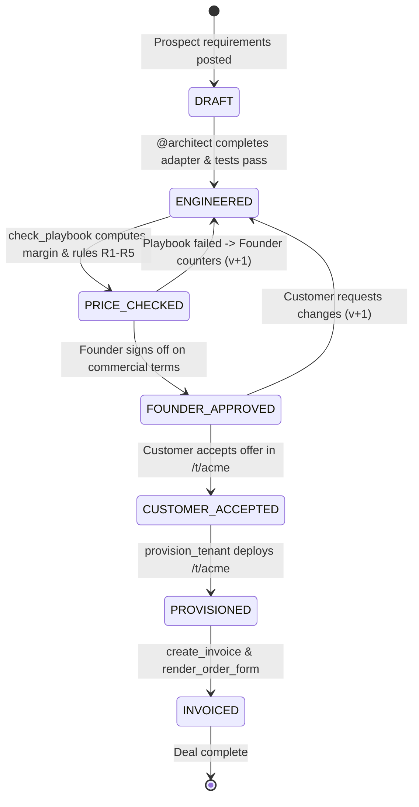

# RelayOS — Comprehensive Requirement Analysis Document (REQUIREMENTS.md)

**Project Name:** RelayOS  
**Hackathon:** Flip the Switch Hackathon (Track 01 — Best Business Workflow)  
**Author:** AI Engineering & Agile Product Team  
**Date:** November 4, 2026  
**Status:** Approved for Agile Development  

---

## 1. Business Problem & Project Objective

### 1.1 The Business Problem
In B2B enterprise software sales, when a high-value prospect asks on a live call for:
1. A bespoke ERP/software adapter,
2. An elevated rate limit (e.g., 1,000 requests/minute),
3. White-label custom branding, and
4. Non-standard commercial terms (e.g., $20,000/yr instead of $24,000 list price),

the deal typically stalls. Closing the deal requires cross-functional coordination between:
- **Sales** (pricing & discounts),
- **Engineering** (adapter feasibility, build time, and infrastructure cost),
- **Finance** (gross margin floors, cash flow terms), and
- **Legal** (order forms, liabilities, payment terms).

This handoff latency takes **7 to 14 business days**. By the time approvals are gathered, momentum is lost, competitive risk rises, and deals often stall or fall through.

### 1.2 The Project Objective
**RelayOS** eliminates this coordination latency by compressing the entire sales-to-engineering-to-finance closing cycle from **"two weeks to one single live chat session."**
- Inside a **Switch** room, the Founder, the Acme Champion, `@architect` (Engineering Agent), and `@deal-desk` (Finance & Operations Agent) collaborate in real time.
- `@architect` builds and tests the custom adapter and estimates infrastructure cost.
- `@deal-desk` deterministically evaluates the price and terms against the company's pricing playbook.
- A **two-party human approval workflow** (Founder approves pricing $\rightarrow$ Customer accepts offer) unlocks execution.
- Upon customer acceptance, the system automatically provisions the white-labeled tenant, generates an Order Form PDF, and issues a mock Stripe invoice.
- A central Admin interface (`/god-mode`) gives the founder complete visibility into DealSpec history, margin gauges, git diffs, test logs, and security audit events.

---

## 2. User Roles & System Actors

| Role | Entity Type | Interface | Permissions & Allowed Actions | Strict Restrictions & Guardrails |
| :--- | :--- | :--- | :--- | :--- |
| **Founder / Admin** | Human | Switch Room & Admin Dashboard (`/god-mode`) | Steer agents, review DealSpec versions, approve commercial terms, override agent proposals, view margin metrics, inspect audit logs and git diffs. | **May NOT skip customer acceptance.** Cannot trigger provisioning or billing without customer consent. |
| **Customer / Acme Champion** | Human | Switch Room & Customer Portal (`/t/acme`) | State requirements, review enterprise proposal, review terms, inspect generated Order Form PDF and invoice, accept or reject proposal. | **May NOT view internal margin**, infrastructure cost, pricing playbook rules, admin controls, or agent tooling. |
| **@architect Agent** | AI Agent (OpenCode / Claude Code) | Switch Room & FastMCP (Server 1) | Read & write `./relayos-app`, run automated pytest tests, execute `estimate_cost`, publish `DealSpec`. | **Forbidden from accessing billing, invoicing, or provisioning tools.** Direct attempts yield HTTP 403 and log a security alert. |
| **@deal-desk Agent** | AI Agent | Switch Room & FastMCP (Server 2) | Read pricing playbook, execute `check_playbook`, call `provision_tenant`, `render_order_form`, and `create_invoice` (only in `CUSTOMER_ACCEPTED` state). | **Forbidden from modifying source code** in `./relayos-app`. |

---

## 3. Functional Requirements (FR)

### Core Capabilities (P0 — Essential MVP)
* **FR-1: Deal Room Orchestration**: Local Switch/Mattermost deal room populated with Founder, Customer Champion, `@architect`, and `@deal-desk` using a declarative Switch room/agent template.
* **FR-2: Scoped `@architect` Tooling**: FastMCP tool isolation ensuring `@architect` can only modify `./relayos-app`, execute pytest, and call `estimate_cost`.
* **FR-3: Schema-Validated DealSpec Contract**: A single, versioned, strictly typed Pydantic contract (`DealSpec`) passed across agents and tools. Versions are immutable (v1 $\rightarrow$ v2); in-place mutation is forbidden.
* **FR-4: Deterministic Cost & Playbook Engine**: Non-LLM mathematical evaluation:
  - Infrastructure Cost = $\$1,000 + (\$7 \times \text{RPM})$.
  - Gross Margin = $(\text{Price} - \text{Infra Cost}) / \text{Price}$.
  - Rules R1 through R5 cited explicitly by rule ID in every verdict.
* **FR-5: Server-Side State Machine Gate**: Provisioning, Order Form PDF generation, and invoice creation are rejected by the backend unless current deal state is strictly `CUSTOMER_ACCEPTED`.
* **FR-6: Dynamic Tenant Routing & Rate Limiting**: Endpoint `/t/{slug}` loads the tenant adapter, serves custom branding, and enforces the DealSpec RPM quota (returns HTTP 429 when quota is exceeded, HTTP 404 for unknown slugs).
* **FR-7: Mock Stripe Billing Engine**: Issues mock invoice with unique ID, formatted amount, terms, and payment link (with optional real Stripe test API key support via `.env`).
* **FR-8: Comprehensive Documentation**: Repository documentation detailing Switch concept mappings, setup commands, and step-by-step reproduction instructions.
* **FR-9: Live Demonstration Artifact**: Video demonstration under 2 minutes showing the complete workflow from request to invoice.

### Usability & Experience (P1 — High Value)
* **FR-10: Automated Order Form PDF**: ReportLab-generated legal Order Form PDF populated with customer name, term length, annual price, rate limit, Net-15 terms, waived setup fee, and signature blocks.
* **FR-11: Admin Console (`/god-mode`)**: Real-time developer dashboard featuring:
  - Live DealSpec visualizer and version diffing ($v1 \rightarrow v2$).
  - Color-coded gross margin bar ($<75\%$ Red, $\ge 75\%$ Green).
  - Real-time audit log stream (including unauthorized denial events).
  - Git diff viewer and test execution results.
  - Active tenant status and mock invoice card.
* **FR-12: Zero-Key Replay Mode**: Pre-recorded agent transcripts driving backend tools, UI state, and audit logs without requiring active AI API keys or Switch Console.
* **FR-13: Execution Timer & Telemetry**: On-screen stopwatch measuring median execution time (target $\le 3:00$ min total, deterministic steps $\le 15$s).

### Enhancements (P2 — Stretch Goals)
* **FR-14: Multi-Room Topology B**: Isolated "Vault Room" for pricing playbook if Switch cross-room handoffs are verified.
* **FR-15: Local Mailpit Outbox**: SMTP capture displaying the dispatched invoice email.
* **FR-16: Hackathon Blog Article**: Narrative write-up for the event side-track.

---

## 4. Non-Functional Requirements (NFR)

* **NFR-1: Determinism & Zero Hallucination**:
  - Pricing rules, margins, and cost computations must be executed in pure Python, never by an LLM prompt.
  - Replay mode must produce bit-for-bit identical DealSpec JSON and PDF text across 5 consecutive runs.
* **NFR-2: Performance & Latency**:
  - Full end-to-end flow from request to invoice completed in $\le 3:00$ minutes (median).
  - Deterministic tool calls (`estimate_cost`, `check_playbook`, `provision_tenant`) execute in $\le 15$ seconds.
* **NFR-3: Reproducibility & Judge Experience**:
  - Clean clone to running state in $\le 10$ minutes on macOS using `uv` and Docker.
  - Replay mode runs immediately with zero external account dependencies.
* **NFR-4: Privilege & Security Isolation (Three-Factor Model)**:
  - *Factor 1 (Addressing)*: `@deal-desk` answers only the Founder and Founder-authorized agents.
  - *Factor 2 (Boundary)*: `@architect` cannot access playbook markdown or root config.
  - *Factor 3 (Tool & Token Gate)*: Separate FastMCP servers; billing tools require a secret token held only by `@deal-desk`.
* **NFR-5: Auditability & Compliance**:
  - Append-only audit log in SQLite recording all actor actions, state transitions, timestamps, and denied attempts.
* **NFR-6: Demo-Grade Subprocess Sandbox**:
  - Tenant adapter code executes in an isolated Python subprocess with a strict execution timeout to prevent runaway resource consumption.

---

## 5. Admin Interface Requirements (`/god-mode`)

The Admin Interface is a developer-focused, high-density dashboard inspired by modern developer platforms (Linear, Vercel, Raycast):
1. **Header & Status Bar**: Displays Deal ID, active version number, deal state pill badge, and live workflow timer.
2. **DealSpec Inspector & Diff Viewer**: Displays current JSON payload with visual diffing between versions (e.g. Acme Ask v1 vs Founder Counter v2).
3. **Margin & Financial Health Gauge**:
   - Visual progress bar showing calculated gross margin.
   - Dynamic thresholding: **Red** when below 75% margin floor, **Green** when $\ge 75\%$.
   - Breakdown of Annual Price, Estimated Infra Cost, and Rule Verdicts (R1–R5).
4. **Agent Activity Stream**: Live feed of messages, tracked task handoffs, and tool execution logs.
5. **Engineering Telemetry**: Real-time display of adapter git diff in `./relayos-app` and automated pytest pass/fail output.
6. **Tenant & Billing Status Cards**:
   - Tenant active status, URL link (`localhost:8000/t/acme`), and RPM quota.
   - PDF preview/download link for generated Order Form.
   - Mock Stripe invoice card with amount, Net-15 terms, and invoice link.
7. **Security & Audit Log**: Chronological list of events; unauthorized attempts highlighted in **Red** (`UNAUTHORIZED_ACCESS_DENIED`).
8. **Founder Action Controls**: One-click "Approve Deal" button to advance state from `PRICE_CHECKED` to `FOUNDER_APPROVED`.

---

## 6. Customer Interface Requirements (`/t/acme`)

The Customer Portal is an enterprise-grade, clean client portal:
1. **Client Branding**: Custom Acme FinTech branding and welcome banner.
2. **Commercial Proposal Summary**: Clear, professional presentation of:
   - Annual Subscription Price ($22,000/yr),
   - Contract Term (12 Months),
   - Rate Limit Allocation (600 Requests/Minute),
   - Payment Terms (Net-15),
   - Setup Fee Status (Waived),
   - White-Label Customization (Included).
3. **Data Redaction & Information Isolation**:
   - **Zero visibility** into internal infrastructure costs ($5,200),
   - **Zero visibility** into gross margin percentage (76.4%),
   - **Zero visibility** into internal pricing playbook rules (R1–R5) or founder margin policies.
4. **Legal & Billing Deliverables**:
   - Embedded Order Form PDF viewer and direct download button.
   - Mock Stripe invoice link with status pill (`ISSUED` / `PAID`).
5. **Interactive Sign-Off Controls**:
   - **"Accept Offer & Sign"** button: advances deal state to `CUSTOMER_ACCEPTED`.
   - **"Request Revisions"** button: returns deal with feedback notes.
6. **Live Tenant Status**: Status indicator confirming when the tenant environment `/t/acme` is provisioned and ready.

---

## 7. Business Rules, Pricing Playbook & Cost Model

### 7.1 Pricing Playbook Rules (Enterprise_Pricing_Playbook.md)

| Rule ID | Rule Name | Specification & Logic |
| :---: | :--- | :--- |
| **R1** | **Margin Floor** | Gross margin must be $\ge 75.0\%$. $\text{Gross Margin} = (\text{Annual Price} - \text{Annual Infra Cost}) / \text{Annual Price}$. |
| **R2** | **Discount Authority** | Enterprise list price is $\$24,000$/yr. Discounts up to $10.0\%$ (price floor $\$21,600$) require no executive exception. Discounts $>10\%$ fail. |
| **R3** | **Setup Fee Waiver** | Standard setup fee is $\$2,500$. Waived automatically if annual price $\ge \$20,000$ and term $\ge 12$ months. |
| **R4** | **Payment Terms** | Standard terms: Net-30. Fast payment Net-15 allowed without exception. Net-60 requires executive exception. |
| **R5** | **White-Label Policy** | White-label custom branding is permitted on Enterprise tier only. |

### 7.2 Deterministic Cost Model (cost_model.py)
$$\text{Annual Infra Cost (USD)} = \$1,000 + (\$7 \times \text{Allocated RPM})$$
- At 1,000 RPM ask: $\$1,000 + (\$7 \times 1,000) = \$8,000/\text{year}$.
- At 600 RPM counter: $\$1,000 + (\$7 \times 600) = \$5,200/\text{year}$.

### 7.3 Scenario Evaluation Matrix

| Scenario Parameter | Acme Initial Ask (DealSpec v1) | Founder Counter-Offer (DealSpec v2) |
| :--- | :--- | :--- |
| **Annual Price** | $\$20,000$ | $\$22,000$ |
| **Rate Limit (RPM)** | 1,000 RPM | 600 RPM |
| **Infra Cost (Model)** | $\$8,000$ | $\$5,200$ |
| **Calculated Margin** | **60.0%** (Fail) | **76.4%** (Pass) |
| **R1 (Margin $\ge 75\%$)** | **FAIL** ($60.0\% < 75.0\%$) | **PASS** ($76.4\% \ge 75.0\%$) |
| **R2 (Discount $\le 10\%$)** | **FAIL** ($16.7\%$ discount against $\$24\text{k}$) | **PASS** ($8.3\%$ discount against $\$24\text{k}$) |
| **R3 (Setup Fee)** | Pass (Waived) | Pass (Waived) |
| **R4 (Payment Terms)** | Pass (Net-30) | Pass (Net-15) |
| **R5 (White-Label)** | Pass (Enterprise) | Pass (Enterprise) |
| **Overall Verdict** | **FAIL** (Requires counter or rejection) | **PASS** (Ready for Founder Approval) |

---

## 8. Deal Lifecycle State Machine & Approval Conditions

### Server-Side Approval & Security Gates:
1. **Gate 1 (Engineering Gate)**: Deal cannot advance to `ENGINEERED` unless adapter tests pass in pytest.
2. **Gate 2 (Pricing Gate)**: Deal cannot advance to `FOUNDER_APPROVED` unless playbook passes or explicit founder override is recorded.
3. **Gate 3 (Customer Sign-Off Gate)**: Deal cannot advance to `CUSTOMER_ACCEPTED` without authenticated customer acceptance.
4. **Gate 4 (Money-Moving Gate — Critical)**: `provision_tenant`, `render_order_form`, and `create_invoice` strictly verify that `state == CUSTOMER_ACCEPTED`. Calls in any earlier state fail with HTTP 400/403.
5. **Gate 5 (Privilege Isolation Gate)**: Any call by `@architect` to billing endpoints is rejected with HTTP 403 and logged to `audit_logs` as `UNAUTHORIZED_ACCESS_DENIED`.

---

## 9. Acceptance Criteria (Acceptance Tests AT-1 through AT-8)

| ID | Test Scenario | Input & Trigger | Expected Result |
| :---: | :--- | :--- | :--- |
| **AT-1** | Initial Ask Playbook Evaluation | DealSpec at $\$20,000$ and $1,000$ RPM | Margin is $60.0\%$; check fails citing R1 and R2. |
| **AT-2** | Intermediate Counter Scenarios | $\$22,000$ at $1,000$ RPM, then $\$20,000$ at $600$ RPM | Both fail R1 with margins of $63.6\%$ and $74.0\%$ respectively. |
| **AT-3** | Founder Counter Full Pass | $\$22,000$, $600$ RPM, Net-15, waived fee, white-label | Margin is $76.4\%$; R1 through R5 all return `"pass"`. |
| **AT-4** | Cost Model Determinism | 5 runs each for $1,000$ RPM and $600$ RPM | Identical outputs: $\$8,000$ and $\$5,200$ every single run. |
| **AT-5** | State Gate Enforcement | Attempt provisioning or invoicing before `CUSTOMER_ACCEPTED` | Request rejected with state error; zero tenant or invoice created. |
| **AT-6** | Privilege Isolation Enforcement | `@architect` attempts to invoke billing tools | Request denied (HTTP 403); alert logged in `audit_logs`. |
| **AT-7** | Live Rate Limiter Verification | $601$ requests in 60s to `/t/acme`; $1$ request to `/t/unknown` | 601st request returns HTTP 429; unknown slug returns HTTP 404. |
| **AT-8** | Commercial Artifact Consistency | Generated PDF and Stripe invoice for DealSpec v2 | Price, terms, RPM limit, waived fee match DealSpec v2 exactly. |

---

## 10. Project Scope, Boundaries & Ambiguities

### 10.1 In-Scope (Hackathon MVP)
- Single live chat session workflow on Switch Console + local Mattermost.
- Deterministic pricing engine, ReportLab PDF generation, mock Stripe billing.
- Admin dashboard (`/god-mode`) and Customer portal (`/t/acme`).
- Two FastMCP servers enforcing tool privilege separation.
- Zero-key replay mode for offline evaluation.

### 10.2 Out-of-Scope (Non-Goals)
- Real payment processing or real credit card charging (stays in mock/test mode).
- Production multi-cloud infrastructure provisioning (simulated via local routing and process isolation).
- Full legal contract redlining or multi-deal multi-tenant CRM.
- Slack or Microsoft Teams bridges (bundled Mattermost is the designated chat surface).

### 10.3 Ambiguities, Risks & Verified Fallbacks
1. **Switch Cross-Room Passing ("Room Links")**:
   - *Risk*: Undocumented or unverified Switch feature.
   - *Fallback*: Default to **Topology A (single room)** where handoffs occur via tracked tasks and tool scoping.
2. **Switch CLI vs UI Template Import**:
   - *Risk*: Console CLI import might require manual GUI interaction.
   - *Fallback*: Provide one-click GUI template import with clear instructions in README.
3. **Agent Account / API Key Requirements**:
   - *Risk*: Judge may not have active OpenCode/Claude Code subscription.
   - *Fallback*: **Replay Mode (FR-12)** ensures 100% testability and demonstration with zero API keys.
