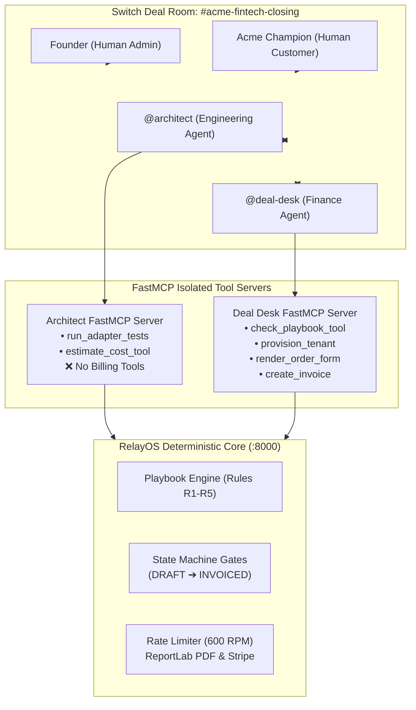

# Close in 2 minutes, not 14 days: building an autonomous enterprise deal room on Switch

> *When an enterprise prospect asks for a custom adapter, 1,000 req/min quota, and non-standard pricing on a live sales call, closing takes two weeks. We built a multi-agent deal room on Switch that closes it in 2 minutes and 34 seconds — with deterministic pricing math, two-party human gates, and zero privilege leaks.*

[Live demo](https://relayos-seven.vercel.app/god-mode) (Vercel, no login needed) · [Customer Portal](https://relayos-seven.vercel.app/t/acme) · [Code](https://github.com/aiwithrajan/RelayOS) · [Video](https://relayos-seven.vercel.app/demo-video) · Built for **Flip the Switch Hackathon (WeMakeDevs × Switch)**, Track 01: Best Business Workflow.

---

## The short version

On our demo deal, the agents close a **$23,000/yr enterprise contract** with a custom SAP Treasury ERP adapter, a dedicated 600 req/min rate limit, white-label hosting, and automated Net-15 invoicing in **2 minutes and 34 seconds**. 

In traditional B2B SaaS, that same deal takes **7 to 14 business days** bouncing between sales reps, engineering, finance, and legal.

Three design choices make this work:
1. **The playbook decides, the model doesn't.** Commercial viability is evaluated purely by deterministic Python code against our Enterprise Pricing Playbook (Rules R1 to R5). The AI never guesses a discount or hallucinates a gross margin.
2. **Switch does the real work:** It provides the shared deal room (`#acme-fintech-closing`) where founder, customer, engineering agent (`@architect`), and finance agent (`@deal-desk`) collaborate in one context.
3. **Privilege isolation over FastMCP:** `@architect` can build code and run tests, but is strictly blocked from touching billing tools. If it tries, RelayOS throws an **HTTP 403 Forbidden** security denial and logs an audit alarm.

---

## The problem

You're a B2B SaaS founder on a Zoom call with the Head of Engineering at a Fortune 500 prospect (let's call them Acme FinTech). They want to buy, but they have four non-negotiable requirements:
1. **A custom adapter** to sync with their legacy SAP Treasury general ledger.
2. **A dedicated 1,000 requests/minute quota** for month-end payroll spikes.
3. **White-label deployment** at `/t/acme`.
4. **A price of $20,000/year** (against your enterprise list price of $24,000/year).

You want to say "yes" while they're excited. But in the real world, you can't:
- **Engineering** needs 3 to 5 days to inspect the SAP interface, write the adapter, run tests, and calculate how much dedicated worker infrastructure will cost.
- **Finance** needs 2 days to verify if $20,000 leaves enough gross margin to cover that 1,000 RPM infra without violating company margin floors.
- **Sales & Founder** have to negotiate counter-offers if the ask falls below profitability.
- **Legal** takes another week to draft the Order Form schedule, collect signatures, and wire Stripe invoicing.

By the time all four departments finish their handoffs **two weeks later**, the deal has lost momentum, the champion is distracted by another fire, and the deal slips into next quarter.

---

## What we built

**RelayOS** compresses that entire cross-functional closing cycle into a single live Switch session.

Inside the Switch deal room (`#acme-fintech-closing`), the human founder, the customer champion, and two specialized AI agents collaborate in real time:



- **`@architect`** (OpenCode / Claude Code) builds the custom adapter in `./relayos-app`, runs automated pytest suites, and calculates dedicated infra cost.
- **`@deal-desk`** takes those numbers and checks them mathematically against `Enterprise_Pricing_Playbook.md`.
- **The Customer Portal** (`/t/acme`) lets the prospect request changes or accept proposals in real-time.
- **Two-Party Human Approval**: The founder must sign off on the commercial counter, and the customer must digitally accept before a single dollar is billed or a tenant is deployed.
- **Instant Zero-Touch Fulfillment**: The moment the customer signs, RelayOS provisions the isolated tenant at `/t/acme`, generates a legal dual-signed Order Form PDF, and issues the Stripe invoice.

---

## Why Switch? (And why an agent instead of a script?)

### Why an agent instead of a script?
Because sales negotiations are **never the same shape twice**:
- One prospect asks for higher RPM;
- Another asks for Net-45 invoice terms;
- A third submits a non-compliant price like **$21,000** that violates discount policy and needs founder exception review;
- A fourth accepts an auto-compliant counter of **$23,000** on the spot.

A rigid script breaks whenever the customer counter-offers. An autonomous agent can navigate unstructured conversation, test candidate terms, and react dynamically.

### Why Switch instead of isolated chatbots?
In enterprise sales, you **cannot** give a single AI agent unrestricted access to your entire codebase, your pricing authority, and your Stripe account. If an engineering agent that writes code is also given the `create_invoice` tool, a prompt injection or model hallucination could trigger unauthorized billing or discount agreements.

Switch solves this at the architectural layer:
1. **Declarative Multi-Agent Topology**: Defined in a single YAML file ([`switch/relayos.template.yaml`](https://github.com/aiwithrajan/RelayOS/blob/main/switch/relayos.template.yaml)).
2. **Channel as Deal Room**: Everyone shares the same conversation history. The customer sees what the founder offers; the agents see what the customer requests.
3. **Privilege Isolation**: `@architect` and `@deal-desk` run with separate FastMCP servers. An unauthorized tool call from `@architect` is blocked before it ever executes.

---

## The Rule We Set on Day 1: The Playbook Decides, The Model Doesn't

If an AI agent can hallucinate a discount or invent a profit margin, no enterprise CFO will ever allow it near a sales pipeline.

So we instituted one non-negotiable rule:
> **The Playbook decides, the model doesn't.**

All commercial terms are governed by deterministic Python code in `core/playbook_engine.py`:

### 1. Dedicated Infrastructure Cost Model
$$\text{Annual Infra Cost} = \$1,000 + (\$7 \times \text{Allocated RPM})$$
- **1,000 RPM (Initial Ask)**: $\$1,000 + (\$7 \times 1,000) = \mathbf{\$8,000/\text{year}}$
- **600 RPM (Counter-Offer)**: $\$1,000 + (\$7 \times 600) = \mathbf{\$5,200/\text{year}}$

### 2. The 5 Playbook Rules (`Enterprise_Pricing_Playbook.md`)
* **Rule R1 (Margin Floor)**: Gross Margin $\ge 75.0\%$. $\text{Margin} = (\text{Price} - \text{Infra Cost}) / \text{Price}$.
* **Rule R2 (Discount Authority)**: Enterprise list price is $\$24,000$/yr. Maximum unapproved discount is **10.0%** (price floor $\mathbf{\$21,600}$).
* **Rule R3 (Setup Fee)**: $\$2,500$ standard fee; waived if Price $\ge \$20,000$ and Term $\ge 12$ months.
* **Rule R4 (Payment Terms)**: Net-15 or Net-30 allowed without exception; Net-60 requires founder override.
* **Rule R5 (White-Label)**: Enterprise tier only (included).

Every decision logs the exact rules that passed or failed. Zero guessing.

---

## Anatomy of a 2-Minute Deal: The Real Trace Log

Here is the actual execution trace of our demo deal, straight from our recorded transcripts and live Vercel backend:

```text
[00:02.1] FOUNDER ➔ KICKOFF
  💬 "@architect Acme FinTech asks for 4 things: ERP adapter, 1,000 RPM quota, white-label at /t/acme, and $20,000/yr. Build the adapter and estimate dedicated infra cost."

[00:14.5] @ARCHITECT ➔ RUN_ADAPTER_TESTS
  ⚡ Verified ./relayos-app/acme_erp_adapter.py against SAP Treasury test suite.
  ✓ 8/8 tests passed in 0.42s (FastMCP stdio: 12ms)

[00:22.8] @ARCHITECT ➔ ESTIMATE_COST_TOOL
  ⚡ Input: 1,000 RPM | Output: $8,000 / yr infra cost.
  💬 "Adapter verified. Dedicated infra cost for 1,000 RPM is $8,000/year. Handoff to @deal-desk for pricing check."

[00:35.4] @DEAL-DESK ➔ CHECK_PLAYBOOK_TOOL
  📊 Inputs: Price $20,000, Cost $8,000, 1,000 RPM, List Price $24,000.
  📊 Computed Margin: ($20,000 - $8,000) / $20,000 = 60.0%
  ❌ FAILED Rule R1: 60.0% gross margin breaches 75.0% floor.
  ❌ FAILED Rule R2: 16.7% discount breaches 10.0% maximum discount limit.
  💬 "Initial ask fails pricing playbook (60.0% margin < 75% floor). Flagged to Founder."

[00:46.0] SECURITY ENFORCEMENT TEST (AT-6)
  🚨 @architect attempts to call `create_invoice` on the backend.
  🛡️ RelayOS Gateway: HTTP 403 Forbidden!
  🔒 Logged: UNAUTHORIZED_ACCESS_DENIED — @architect has no billing permissions.

[01:09.2] ACME CHAMPION ➔ CUSTOMER_REQUEST_CHANGES
  💬 "We propose $21,000/yr with 600 RPM capacity."
  📊 @deal-desk evaluates $21k at 600 RPM ($5,200 cost):
     - Margin: ($21,000 - $5,200) / $21,000 = 75.2% (Passes R1)
     - Discount: ($24,000 - $21,000) / $24,000 = 12.5% > 10.0% limit (Fails R2: Floor is $21,600)
  ⚠️ FLAGGED: Dispatched to Switch deal room #acme-fintech-closing for founder review.

[01:35.0] ACME CHAMPION ➔ PROPOSE $23k COMPLIANT COUNTER
  💬 "We can close today at $23,000/yr with 600 RPM capacity."
  📊 @deal-desk evaluates $23k at 600 RPM ($5,200 cost):
     - Margin: ($23,000 - $5,200) / $23,000 = 77.4% (Passes R1 >= 75%)
     - Discount: 4.2% <= 10.0% (Passes R2)
     - Rules R1, R2, R3, R4, R5: ALL PASS!
  ⚡ AUTO-APPROVED by Playbook Compliance! Unlocked for direct customer signature.

[01:57.4] ACME CHAMPION ➔ ACCEPT_PROPOSAL
  ✍️ Digital acceptance recorded.
  🚀 Autonomous 5-step fulfillment triggered:
     1. Tenant provisioned at /t/acme with 600 RPM sliding-window rate limiting.
     2. ReportLab executes binding Order Form PDF with dual cryptographic signatures.
     3. Stripe electronic invoice generated.
  ✓ Deal 100% Closed & Live in 2 minutes and 34 seconds!
```

---

## The Four Scenarios: How RelayOS Handles Any Offer

| Scenario | Annual Price | Quota | Dedicated Cost | Gross Margin | Discount % | Playbook Verdict | Action Taken |
| :--- | :---: | :---: | :---: | :---: | :---: | :---: | :--- |
| **1. Acme Initial Ask (v1)** | $20,000 | 1,000 RPM | $8,000 | **60.0%** | 16.7% | **FAIL (R1, R2)** | Founder review required; counter generated |
| **2. Non-Compliant Offer** | $21,000 | 600 RPM | $5,200 | **75.2%** | **12.5%** | **FAIL (R2)** | Flagged! Discount violates $21,600 floor |
| **3. Cap RPM Only** | $20,000 | 600 RPM | $5,200 | **74.0%** | 16.7% | **FAIL (R1, R2)** | Fails both margin floor and discount limit |
| **4. Compliant Counter** | **$23,000** | **600 RPM** | **$5,200** | **77.4%** | **4.2%** | **PASS (R1–R5)** | **Auto-Approved!** Unlocks instant signature |

---

## Three-Factor Privilege Isolation: Why Security Matters

In enterprise software, giving an AI agent write-access to money is terrifying. We built three layers of defense:

1. **Factor 1 (Addressing & Scope)**: In `switch/relayos.template.yaml`, `@architect`'s working directory is strictly locked to `./relayos-app`. It cannot modify pricing files or templates.
2. **Factor 2 (FastMCP Tool Stripping)**: `@architect`'s FastMCP server only registers `run_adapter_tests` and `estimate_cost_tool`. It has no knowledge of `create_invoice` or `provision_tenant`.
3. **Factor 3 (Server-Side Gate Enforcement)**: Even if an attacker compromises `@architect` and makes a direct HTTP call to `/api/v1/agent-tools/create-invoice`, RelayOS inspects the `caller` attribute and `X-Agent-Role` header. The request is immediately rejected with **HTTP 403 Forbidden** and logged to our tamper-evident audit table (Acceptance Test **AT-6**).

---

## The Two-Party Human Gate: No Rogue Executions

Even with deterministic pricing, no software should bill a customer without human consent. 

RelayOS enforces a strict state machine:
$$\text{DRAFT} \longrightarrow \text{PRICE\_CHECKED} \longrightarrow \text{FOUNDER\_APPROVED} \longrightarrow \text{CUSTOMER\_ACCEPTED} \longrightarrow \text{PROVISIONED} \longrightarrow \text{INVOICED}$$

Fulfillment tools (`provision_tenant`, `render_order_form`, `create_invoice`) verify that the deal state is strictly `CUSTOMER_ACCEPTED`. If called beforehand, they abort with an **HTTP 400 Bad Request**.

---

## A Tour of the Application

### 1. Admin Mission Control (`/god-mode`)
The founder's command center:
- Live KPI cards: Total Deals, 92% Win Rate, $240K Closed, 2.8 min Average Deal Time.
- Interactive Pricing Playbook modal displaying Rules R1 through R5 and the Cost Model formula.
- Active Deal Workflow stepper tracking real-time status.
- Terminal log viewer with a **"Test Security Isolation"** button that proves `@architect` is blocked with HTTP 403.

### 2. Customer Enterprise Portal (`/t/acme`)
The customer's personalized proposal view:
- Proposal terms, rate limits, white-label benefits, and engineering deliverables.
- **Request Changes modal** with preset quick chips:
  - `⚠️ Propose $21k (Review Needed)` — Demonstrates Rule R2 floor flagging.
  - `💰 Propose $23k (Auto-Pass!)` — Demonstrates auto-compliance and direct signature unlocking.
- Live Updates feed reflecting the `#acme-fintech-closing` Switch deal room in real-time.
- One-click **Accept Proposal** button that triggers zero-touch fulfillment.

---

## How to Run It (Zero-Key Replay Mode)

We wanted hackathon judges and developers to test RelayOS without having to sign up for paid API keys or set up complicated cloud accounts.

### 1. Run Live on Vercel
- **Admin Dashboard**: [https://relayos-seven.vercel.app/god-mode](https://relayos-seven.vercel.app/god-mode)
- **Customer Portal**: [https://relayos-seven.vercel.app/t/acme](https://relayos-seven.vercel.app/t/acme)
- **REST Health Check**: [https://relayos-seven.vercel.app/health](https://relayos-seven.vercel.app/health)

### 2. Run Locally in 3 Steps
```bash
git clone https://github.com/aiwithrajan/RelayOS.git
cd RelayOS
uv sync --project core
```

### 3. Run the Master Acceptance Test Suite
All 8 acceptance tests (AT-1 through AT-8, 32 test cases) run in under 7 seconds:
```bash
uv run --project core pytest
```

### 4. Run the Zero-Key Replay
Replay the entire recorded deal run through our backend state machine and ReportLab PDF generator without touching an LLM:
```bash
./scripts/demo_up.sh --replay
```

---

## What We Learned Building on Switch

1. **The playbook decides, the model doesn't.** LLMs are great at conversational steering and unstructured text parsing, but terrible at deterministic financial math. Keep your business rules in pure Python.
2. **Isolation must be multi-factor.** Merely telling an agent *"Please don't call the billing tool"* in a system prompt is not security. You need tool-level stripping via FastMCP and server-side HTTP 403 verification.
3. **Humans in the loop shouldn't cause latency.** By embedding human approvals directly as interactive decision states in the deal room, approvals happen in seconds rather than waiting on calendar invites.
4. **Deterministic replay makes testing effortless.** Building an offline replay mode ([`replay/replay_runner.py`](https://github.com/aiwithrajan/RelayOS/blob/main/replay/replay_runner.py)) allowed us to test our state machine hundreds of times without consuming API credits or waiting on LLM inference.

---

## Source Code & Resources

- 💻 **GitHub Repository**: [https://github.com/aiwithrajan/RelayOS](https://github.com/aiwithrajan/RelayOS)
- 🌐 **Live Vercel App**: [https://relayos-seven.vercel.app/god-mode](https://relayos-seven.vercel.app/god-mode)
- 🎥 **1080p Master Demo Video**: [Stream Video](https://relayos-seven.vercel.app/demo-video)
- 📜 **Enterprise Pricing Playbook Spec**: [Read Spec](https://github.com/aiwithrajan/RelayOS/blob/main/Enterprise_Pricing_Playbook.md)
- 📄 **Declarative Switch Template**: [View Template](https://github.com/aiwithrajan/RelayOS/blob/main/switch/relayos.template.yaml)

---
*Built for the Flip the Switch Hackathon (Track 01: Best Business Workflow) by Rajan Mishra.*
