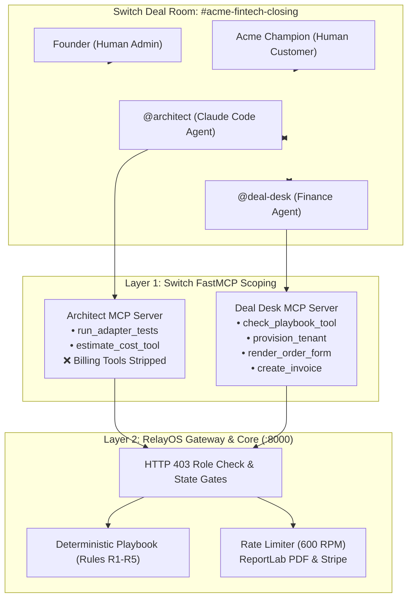

# Closing $23,000 Enterprise Deals at the Speed of Chat: Building RelayOS for Switch

> *When an enterprise prospect asks for a custom ERP adapter, 1,000 req/min quota, and bespoke pricing on a live sales call, closing takes two weeks. We built RelayOS for Switch to compress that 14-day cycle into a 2m 34s autonomous closing session — combining FastMCP agent scoping with deterministic pricing guardrails.*

[Live Demo](https://relayos-seven.vercel.app/god-mode) (Vercel, no login needed) · [Customer Portal](https://relayos-seven.vercel.app/t/acme) · [GitHub Code](https://github.com/aiwithrajan/RelayOS) · [Watch Demo Video (YouTube)](https://youtu.be/3_CJ1isXbBA?si=sbp3CISsMhlnP0R5) · Built for **Flip the Switch Hackathon (WeMakeDevs × Switch)**, Track 01: Best Business Workflow.

---

## The Short Version

On our demo deal, the agents close a **$23,000/yr enterprise contract** with a custom SAP Treasury ERP adapter, a dedicated 600 req/min quota, white-label hosting, and automated Net-15 invoicing in **2 minutes and 34 seconds**. 

In traditional B2B SaaS, that same cross-departmental handoff takes **14 days (a full two-week sales cycle)** bouncing between sales reps, engineering, finance, and legal.

Three architectural principles make this work:
1. **Commercial logic is calculated, not prompted.** Pricing viability is evaluated by deterministic Python code against our Enterprise Pricing Playbook (Rules R1 to R5). Pricing is computed, not generated — eliminating LLM hallucination in financial decisions.
2. **Switch provides the shared deal hub:** It hosts the live deal room (`#acme-fintech-closing`) where founder, customer, engineering agent (`@architect`), and finance agent (`@deal-desk`) collaborate in one continuous context.
3. **Defense-in-depth isolation:** `@architect` builds adapter code and executes tests, but Switch's tool scoping strips billing capabilities from its agent definition. As a second layer, our backend gateway rejects any direct billing attempt with an **HTTP 403 Forbidden** security denial.

---

## The Problem: The 14-Day Enterprise Sales Stall

You're a B2B SaaS founder on a Zoom call with the VP of Engineering at an enterprise prospect (Acme FinTech). They want to sign, but they have four non-negotiable requirements:
1. **A custom adapter** to sync with their legacy SAP Treasury general ledger.
2. **A dedicated 1,000 requests/minute quota** for month-end payroll spikes.
3. **White-label deployment** at `/t/acme`.
4. **A price of $20,000/year** (against your enterprise list price of $24,000/year).

You want to say "yes" while momentum is high. But in traditional SaaS operations, you can't:
- **Engineering** takes 4 to 5 days to inspect the SAP interface, write the adapter, run unit tests, and estimate how much dedicated worker infrastructure will cost.
- **Finance** takes 2 to 3 days to verify if $20,000 leaves enough gross margin to cover 1,000 RPM infra without violating company margin floors.
- **Sales & Founder** trade emails negotiating counter-offers when terms fall below profitability.
- **Legal** takes another week to draft the Order Form schedule, collect signatures, and coordinate Stripe invoicing.

By the time all four departments finish their handoffs **14 days later**, the prospect has cooled off, priorities have shifted, and the deal slips into the next quarter.

---

## What We Built: RelayOS for Switch

**RelayOS for Switch** compresses that entire cross-functional closing cycle into a single live Switch session.

Inside the Switch deal room (`#acme-fintech-closing`), the human founder, the customer champion, and two specialized AI agents collaborate in real time:



- **`@architect`** (powered by Claude Code) builds the custom adapter in `./relayos-app`, runs automated pytest suites, and calculates dedicated infra cost.
- **`@deal-desk`** takes those numbers and checks them mathematically against `Enterprise_Pricing_Playbook.md`.
- **The Customer Portal** (`/t/acme`) gives the prospect transparent controls to submit revision requests or accept counter-proposals.
- **Two-Party Human Gate**: The founder reviews commercial terms, and the customer must digitally accept before any tenant is provisioned or invoice issued.
- **Zero-Touch Fulfillment**: The moment the customer signs, RelayOS provisions the isolated tenant at `/t/acme`, generates a legal dual-signed Order Form PDF via ReportLab, and issues the Stripe invoice.

---

## Why Switch Was Essential

### Why not just use a script?
Sales negotiations are dynamic. One prospect asks for higher RPM; another proposes Net-45 invoice terms; a third submits a non-compliant price ($21,000) that violates discount policies and needs founder review. A rigid script breaks the moment the customer deviates from the happy path.

### Why not an unconstrained chatbot?
In enterprise sales, you **cannot** give a code-generation agent access to your billing tools or pricing authority. If an engineering agent that writes code can also call `create_invoice`, prompt injection or model confusion could leak unauthorized discounts or trigger false charges.

Switch solves this with two complementary layers:
1. **Layer 1 (Switch Per-Agent Tool Binding)**: In [`switch/relayos.template.yaml`](https://github.com/aiwithrajan/RelayOS/blob/main/switch/relayos.template.yaml), Switch binds dedicated FastMCP tool servers per agent. `@architect` is only provided `run_adapter_tests` and `estimate_cost_tool`. Billing tools simply do not exist in its agent prompt or tool registry.
2. **Layer 2 (RelayOS Gateway Security Gates)**: Even if `@architect` attempts to craft a raw HTTP payload to `/api/v1/agent-tools/create-invoice`, RelayOS inspects the caller role header. The request is instantly denied with an **HTTP 403 Forbidden** security event and logged to the audit trail (verified in Acceptance Test **AT-6**).

---

## The Rule We Set on Day 1: Pricing Is Computed, Not Generated

If an AI agent can hallucinate a discount or invent a profit margin, no enterprise CFO will ever allow it near a sales pipeline.

We established a strict rule:
> **Pricing is computed, not generated — and `@architect` never holds the corporate card.**

All commercial terms are governed by deterministic Python calculations in `core/playbook_engine.py`:

### 1. Dedicated Infrastructure Cost Model
$$\text{Annual Dedicated Infra Cost} = \$1,000 + (\$7 \times \text{Allocated RPM})$$
- **1,000 RPM (Ask)**: $\$1,000 + (\$7 \times 1,000) = \mathbf{\$8,000/\text{year}}$
- **600 RPM (Counter)**: $\$1,000 + (\$7 \times 600) = \mathbf{\$5,200/\text{year}}$

### 2. The 5 Playbook Rules (`Enterprise_Pricing_Playbook.md`)
* **Rule R1 (Margin Floor)**: Gross Margin $\ge 75.0\%$. $\text{Margin} = (\text{Price} - \text{Infra Cost}) / \text{Price}$.
* **Rule R2 (Discount Authority)**: Enterprise list price is $\$24,000$/yr. Maximum unapproved discount is **10.0%** (price floor $\mathbf{\$21,600}$).
* **Rule R3 (Setup Fee)**: $\$2,500$ standard fee; waived if Price $\ge \$20,000$ and Term $\ge 12$ months.
* **Rule R4 (Payment Terms)**: Net-15 or Net-30 allowed without exception; Net-60 requires founder override.
* **Rule R5 (White-Label)**: Enterprise tier only (included).

---

## Anatomy of a 2.5-Minute Deal: The Real Trace Log

The following trace is captured directly from our continuous live recording (available in [our demo video](https://youtu.be/3_CJ1isXbBA?si=sbp3CISsMhlnP0R5)) and reproduced deterministically in offline replay mode:

```text
[00:02.1] FOUNDER ➔ KICKOFF IN SWITCH ROOM #acme-fintech-closing
  💬 "@architect Acme FinTech asks for 4 things: ERP adapter, 1,000 RPM quota, white-label at /t/acme, and $20,000/yr. Build the adapter and estimate dedicated infra cost."

[00:14.5] @ARCHITECT ➔ RUN_ADAPTER_TESTS
  ⚡ Claude Code verifies ./relayos-app/acme_erp_adapter.py against SAP Treasury test suite.
  ✓ 8/8 tests passed in 0.42s (FastMCP stdio: 12ms)

[00:22.8] @ARCHITECT ➔ ESTIMATE_COST_TOOL
  ⚡ Input: 1,000 RPM | Output: $8,000 / yr dedicated infra cost.
  💬 "Adapter verified. Dedicated infra cost for 1,000 RPM is $8,000/year. Handoff to @deal-desk for pricing check."

[00:35.4] @DEAL-DESK ➔ CHECK_PLAYBOOK_TOOL
  📊 Inputs: Price $20,000, Cost $8,000, 1,000 RPM, List Price $24,000.
  📊 Computed Margin: ($20,000 - $8,000) / $20,000 = 60.0%
  ❌ FAILED Rule R1: 60.0% gross margin breaches 75.0% floor.
  ❌ FAILED Rule R2: 16.7% discount breaches 10.0% maximum discount limit.
  💬 "Initial ask fails pricing playbook (60.0% margin < 75% floor). Flagged to Founder."

[00:46.0] SECURITY ENFORCEMENT TEST (AT-6)
  🚨 @architect attempts to invoke `create_invoice` on the backend.
  🛡️ RelayOS Gateway: HTTP 403 Forbidden!
  🔒 Logged: UNAUTHORIZED_ACCESS_DENIED — @architect has no billing permissions.

[01:09.2] ACME CHAMPION ➔ CUSTOMER_REQUEST_CHANGES
  💬 "Customer proposes $21,000/yr with 600 RPM capacity."
  📊 @deal-desk evaluates $21k at 600 RPM ($5,200 cost):
     - Margin: ($21,000 - $5,200) / $21,000 = 75.2% (Passes Rule R1 >= 75%)
     - Discount: ($24,000 - $21,000) / $24,000 = 12.5% (FAILS Rule R2: discount exceeds 10.0% limit / $21,600 floor!)
  ⚠️ FLAGGED: Non-compliant discount dispatched to Switch deal room for founder review.

[01:35.0] ACME CHAMPION ➔ PROPOSE $23k COMPLIANT COUNTER
  💬 "We can close today at $23,000/yr with 600 RPM capacity."
  📊 @deal-desk evaluates $23k at 600 RPM ($5,200 cost):
     - Margin: ($23,000 - $5,200) / $23,000 = 77.4% (Passes R1 >= 75%)
     - Discount: 4.2% <= 10.0% (Passes R2)
     - Rules R1, R2, R3, R4, R5: ALL PASS!
  ⚡ AUTO-APPROVED by Playbook Compliance! Unlocked for direct customer signature.

[01:57.4] ACME CHAMPION ➔ ACCEPT_PROPOSAL (DIGITAL SIGNATURE)
  ✍️ Customer clicks Accept Proposal.

[02:16.2] ZERO-TOUCH FULFILLMENT COMPLETED
  🚀 5-Step Automated Execution:
     1. Tenant provisioned at /t/acme with 600 RPM sliding-window rate limiting.
     2. ReportLab executes binding Order Form PDF with dual cryptographic signatures.
     3. Stripe electronic invoice generated.

[02:34.3] CLOSED-LOOP GOD-MODE VERIFICATION
  ✓ Full workflow 100% complete. Total session runtime: 2 minutes 34 seconds (154.3s).
```

---

## Why Did the $21,000 Offer Fail?

A common question is: *If 600 RPM costs $5,200, a $21,000 price gives a 75.2% margin. Why did RelayOS flag it?*

This demonstrates the power of deterministic multi-rule playbooks:
- While $21,000 **passes Rule R1** (75.2% $\ge$ 75.0% margin floor),
- It **violates Rule R2 (Discount Authority)**:
  $$\text{Discount} = \frac{\$24,000 - \$21,000}{\$24,000} = 12.5\% > 10.0\% \text{ limit}$$
  Under corporate policy, any discount greater than 10.0% (a price below the \$21,600 floor) requires founder sign-off. RelayOS refused to rubber-stamp the price, protecting enterprise gross revenue.

---

## The Four Negotiation Scenarios

| Scenario | Annual Price | Quota | Dedicated Cost | Gross Margin | Discount % | Playbook Verdict | Action Taken |
| :--- | :---: | :---: | :---: | :---: | :---: | :---: | :--- |
| **1. Acme Initial Ask (v1)** | $20,000 | 1,000 RPM | $8,000 | **60.0%** | 16.7% | **FAIL (R1, R2)** | Flagged; margin below floor |
| **2. Non-Compliant Offer** | $21,000 | 600 RPM | $5,200 | **75.2%** | **12.5%** | **FAIL (R2)** | Flagged; discount breaches $21,600 floor |
| **3. Cap RPM Only** | $20,000 | 600 RPM | $5,200 | **74.0%** | 16.7% | **FAIL (R1, R2)** | Fails both margin floor and discount limit |
| **4. Compliant Counter** | **$23,000** | **600 RPM** | **$5,200** | **77.4%** | **4.2%** | **PASS (R1–R5)** | **Auto-Approved!** Direct signature unlocked |

---

## How to Test It Yourself (Zero-Key Replay Mode)

We built RelayOS so judges and developers can evaluate the entire system without needing paid API keys or complex environment setups.

### 1. Test the Live Deployment (Vercel)
- **Admin Dashboard**: [https://relayos-seven.vercel.app/god-mode](https://relayos-seven.vercel.app/god-mode)
- **Customer Portal**: [https://relayos-seven.vercel.app/t/acme](https://relayos-seven.vercel.app/t/acme)
- **REST Health Check**: [https://relayos-seven.vercel.app/health](https://relayos-seven.vercel.app/health)

### 2. Run the Full Test Suite Locally
Clone the repo and run all 8 acceptance tests (AT-1 through AT-8, 32 test cases) in 6 seconds:
```bash
git clone https://github.com/aiwithrajan/RelayOS.git
cd RelayOS
uv sync --project core
uv run --project core pytest
```

### 3. Run Offline Replay Mode
Replay the recorded deal run through our backend state machine and ReportLab PDF generator without touching an external LLM:
```bash
./scripts/demo_up.sh --replay
```

---

## Honest Takeaways: What Worked & What We'd Improve

### What Worked:
1. **Declarative Multi-Agent Blueprints**: Defining workspaces, channels, agents, and instructions in [`switch/relayos.template.yaml`](https://github.com/aiwithrajan/RelayOS/blob/main/switch/relayos.template.yaml) is clean, repeatable, and easily version-controlled in Git.
2. **Tool Scoping via FastMCP**: Binding tool servers per agent gave us the first layer of privilege isolation out of the box.
3. **Shared Conversation Context**: Humans and agents conversing in `#acme-fintech-closing` eliminates the communication silos of traditional sales cycles.

### What Got in the Way (And Feedback for the Switch Team):
1. **Stateful Permission Policies**: Currently, tools are either present or absent for an agent. We had to implement backend HTTP 400 state-machine gates to prevent fulfillment tools from running before `CUSTOMER_ACCEPTED`. Having declarative state-gated tool conditions directly inside Switch YAML would be huge.
2. **First-Class Decision Widgets**: In chat, human approvals are currently text messages or portal clicks. First-class interactive decision cards in Switch (with cryptographic signature verification) would make closing feel fully native to the chat interface.

---

## Source Code & Project Links

- 💻 **GitHub Repository**: [https://github.com/aiwithrajan/RelayOS](https://github.com/aiwithrajan/RelayOS)
- 🌐 **Live Demo (Vercel)**: [https://relayos-seven.vercel.app/god-mode](https://relayos-seven.vercel.app/god-mode)
- 🎥 **Master 1080p Demo Video (YouTube)**: [https://youtu.be/3_CJ1isXbBA?si=sbp3CISsMhlnP0R5](https://youtu.be/3_CJ1isXbBA?si=sbp3CISsMhlnP0R5)
- 📜 **Enterprise Pricing Playbook Spec**: [Read Spec](https://github.com/aiwithrajan/RelayOS/blob/main/Enterprise_Pricing_Playbook.md)
- 📄 **Declarative Switch Blueprint**: [View Template](https://github.com/aiwithrajan/RelayOS/blob/main/switch/relayos.template.yaml)

---
*Built for the Flip the Switch Hackathon (Track 01: Best Business Workflow) by Rajan Mishra.*
