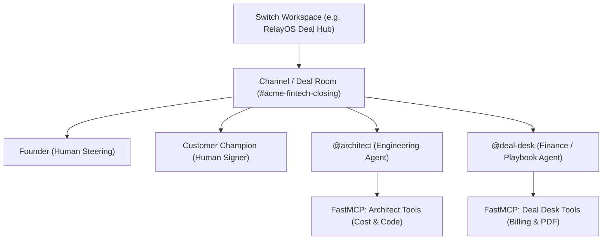

# Building RelayOS with Switch: The Complete Guide to Orchestrating Multi-Agent Business Workflows

> *How to turn two weeks of enterprise sales, engineering, and legal friction into a 2-minute autonomous session using Switch, FastMCP, and deterministic guardrails.*

---

## 1. Why Switch Changes the Game for AI Agents

If you've built with AI agents recently, you've likely hit the "single-agent sandbox" ceiling. An agent running in a private terminal (like Claude Code or Codex) is incredible at editing code, but real businesses don't run on code alone. They run on **cross-functional collaboration**:
- **Engineering** evaluates feasibility and builds adapters.
- **Finance** calculates gross margins and enforces pricing floors.
- **Sales & Founders** steer negotiations and approve custom terms.
- **Customers** review contracts and sign on the dotted line.

Before **Switch**, orchestrating this required duct-taping disjointed Slack bots, brittle webhooks, and bespoke agent harnesses. 

**Switch flips this entirely.** Switch treats AI agents and humans as first-class citizens in a shared workspace. It provides:
1. **Shared Context**: Agents and humans converse in the same room (`acme-fintech-closing`).
2. **Declarative Topology**: You define your agents, channels, and rules in a single declarative YAML template (`relayos.template.yaml`).
3. **Privilege Isolation & FastMCP**: Different agents have access to strictly scoped tools—preventing an engineering agent from accidentally issuing invoices or discounting prices.

In this guide, we'll walk through exactly how to build a production-grade multi-agent business system using Switch, using our project **RelayOS** as a real-world case study.

---

## 2. Switch 101: The Core Concepts Every First-Time Developer Needs to Know

If you are opening Switch for the first time, here is the mental model in 60 seconds:



1. **Workspace**: The top-level boundary for your team, agents, and tool configurations.
2. **Channel / Room**: The collaborative session where work happens. A room can host humans, agents, or both.
3. **Room Instructions**: The natural language rules of engagement. For instance: *"@architect must never quote commercial terms. Only @deal-desk can verify pricing."*
4. **FastMCP Servers**: Standards-based Model Context Protocol servers running over stdio or HTTP that expose specific executable functions to authorized agents.
5. **Decisions Log & Shared State**: An immutable log of verdicts, state transitions, and audit records shared across all participants.

---

## 3. Step-by-Step: Writing Your First Declarative Switch Template

Switch allows you to declare your entire multi-agent infrastructure in code. Below is the blueprint from our repository ([`switch/relayos.template.yaml`](https://github.com/aiwithrajan/RelayOS/blob/main/switch/relayos.template.yaml)):

```yaml
version: "1.0"

workspace:
  name: "RelayOS Enterprise Deal Hub"
  description: "Autonomous deal negotiation, engineering adapter verification, and deterministic playbook closing."

channels:
  - id: "relay-deal-room"
    name: "acme-fintech-closing"
    purpose: "Live closing session with Acme FinTech, Founder, @architect, and @deal-desk."
    members:
      - "founder"
      - "acme_champion"
      - "@architect"
      - "@deal-desk"
    instructions: |
      This room is governed by RelayOS enterprise closing policies:
      - @architect handles adapter code and infrastructure cost estimation only.
      - @architect must NEVER quote prices, terms, or discounts.
      - @deal-desk evaluates the pricing playbook against Rules R1 through R5.
      - No tenant provisioning or invoicing can occur without Founder Approval and Customer Acceptance.

agents:
  - name: "@architect"
    role: "Engineering Agent"
    model: "claude-code" # Or OpenCode / Codex
    working_directory: "./relayos-app"
    description: "Builds customer adapters and verifies tests."
    mcp_servers:
      - name: "architect-mcp"
        command: "python"
        args: ["-m", "mcp.architect_tools"]
        tools:
          - "estimate_cost_tool"
          - "run_adapter_tests"
    permissions:
      forbidden_tools:
        - "create_invoice"
        - "provision_tenant"

  - name: "@deal-desk"
    role: "Finance & Operations Agent"
    mcp_servers:
      - name: "deal-desk-mcp"
        command: "python"
        args: ["-m", "mcp.deal_desk_tools"]
        tools:
          - "check_playbook_tool"
          - "provision_tenant"
          - "render_order_form"
          - "create_invoice"
```

### Why this structure is so powerful:
- **Zero Ambiguity**: Each agent's duties are hardcoded in the declarative spec.
- **Multi-Factor Privilege Isolation**: Even if `@architect` gets prompted by a user to issue an invoice, Switch strips the `create_invoice` tool from its tool context. Furthermore, the backend enforces an **HTTP 403 Forbidden** security denial if an unauthorized caller attempts a direct call.

---

## 4. Real-World Case Study: How RelayOS Closes a Deal in 2 Minutes

Let's look at how RelayOS executes this workflow step-by-step:

### Step 1: The Prospect's Non-Standard Ask ($20k / 1,000 RPM)
Acme FinTech asks for a custom SAP Treasury adapter, a high 1,000 requests/minute quota, white-label branding, and a discounted price of $20,000/yr (against $24,000 list).

### Step 2: @architect Estimates Dedicated Cost
In Switch, `@architect` builds `relayos-app/acme_erp_adapter.py`, runs `pytest` (passing 8/8 tests), and executes the cost model tool:
$$\text{Cost} = \$1,000 + (\$7 \times 1,000\text{ RPM}) = \$8,000/\text{year}$$

### Step 3: @deal-desk Evaluates the Pricing Playbook
`@deal-desk` takes the numbers and checks company policy deterministically (zero LLM hallucination):
- **Gross Margin**: $(\$20,000 - \$8,000) / \$20,000 = 60.0\%$
- **Verdict**: **FAIL ❌** (Fails **Rule R1**: 60% < 75% margin floor; fails **Rule R2**: 16.7% discount exceeds 10% maximum limit).

### Step 4: The Customer's Non-Compliant Revision ($21,000 Offer)
In the Customer Portal, Acme proposes $21,000 at 600 RPM.
- Cost drops to $\$1,000 + (\$7 \times 600) = \$5,200/\text{year}$.
- Margin is $(\$21,000 - \$5,200) / \$21,000 = 75.2\%$ (passes R1).
- **BUT Rule R2 Fails**: $(24,000 - 21,000) / 24,000 = 12.5\%$ discount, which breaches the 10.0% unapproved discount limit ($21,600 floor).
- Switch flags the offer in real-time and dispatches it to `#acme-fintech-closing` for founder exception review.

### Step 5: The Compliant Counter & Instant Auto-Approval ($23,000 Offer)
Acme counter-proposes $23,000 at 600 RPM.
- Margin: $(\$23,000 - \$5,200) / \$23,000 = 77.4\%$ (passes R1).
- Discount: $4.2\% \le 10.0\%$ (passes R2).
- Rules R1 through R5 **ALL PASS**!
- RelayOS **auto-approves** the proposal on the spot and unlocks digital signature.

### Step 6: Customer Signs & Autonomous Zero-Touch Fulfillment
When the customer clicks **Accept Proposal**, RelayOS executes 5 steps automatically:
1. Provisions isolated tenant at `/t/acme` with dedicated 600 RPM sliding-window rate limiting.
2. Generates an executed, dual-signature **Order Form PDF** using ReportLab.
3. Issues a Stripe electronic invoice.
4. Updates God-Mode Mission Control with a cryptographic audit trail.

---

## 5. Pro-Tips for First-Time Switch Builders

1. **Keep Business Logic Deterministic**:
   Don't ask an LLM *"Do you think this price is fair?"* LLMs hallucinate numbers. Use Switch agents to collect inputs and coordinate actions, but run calculations through deterministic Python code.
2. **Enforce Three-Factor Security Isolation**:
   - **Factor 1 (Addressing)**: Deal desk agents should only take orders from designated executive roles.
   - **Factor 2 (Scope)**: Code agents should only have filesystem access to their specific workspace directory.
   - **Factor 3 (Tools)**: Never give billing or provisioning tools to code-generation agents.
3. **Build a "Zero-Key Replay Mode"**:
   For hackathons and user demos, always build an offline replay script ([`replay/replay_runner.py`](https://github.com/aiwithrajan/RelayOS/blob/main/replay/replay_runner.py)) that feeds pre-recorded transcripts into your local state machine. This allows judges and users to test your app instantly without API keys or setup friction.

---

## 6. Try RelayOS Live!

- 🌐 **Live Demo (Vercel)**: [https://relayos-seven.vercel.app/god-mode](https://relayos-seven.vercel.app/god-mode)
- 🏢 **Customer Portal**: [https://relayos-seven.vercel.app/t/acme](https://relayos-seven.vercel.app/t/acme)
- 💻 **Open-Source GitHub**: [https://github.com/aiwithrajan/RelayOS](https://github.com/aiwithrajan/RelayOS)
- 🎥 **Master 1080p Demo Video**: [Stream Live](https://relayos-seven.vercel.app/demo-video)
- 📜 **Enterprise Pricing Playbook Spec**: [Read Spec](https://github.com/aiwithrajan/RelayOS/blob/main/Enterprise_Pricing_Playbook.md)

---
*Built for the Flip the Switch Hackathon (Track 01: Best Business Workflow) by Rajan Mishra.*
