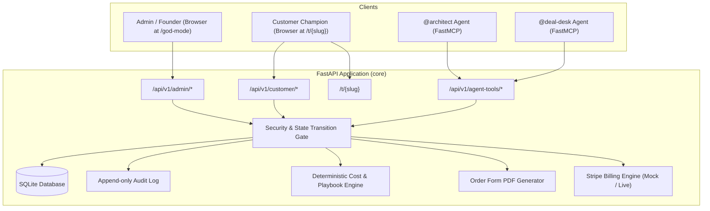
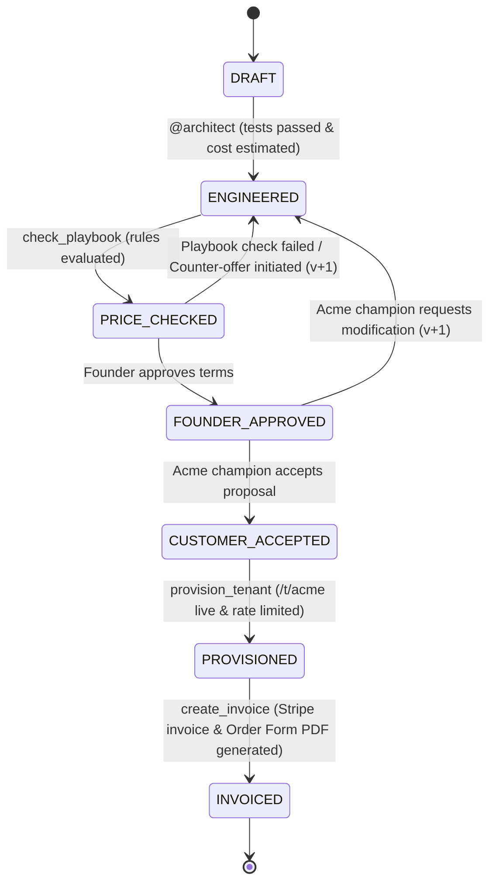

# RelayOS — System Architecture & Database Design Specification

## 1. Backend Architecture

RelayOS is built around a secure, auditable, event-and-state-driven architecture.
The backend serves as the single source of truth for all deal state transitions, financial calculations, multi-tenant routing, and audit logging.



---

## 2. Database Schema (SQLite)

The database schema guarantees immutable version history for DealSpecs, tamper-evident audit trails, and strict isolation between tenant environments.

### Table: `deals`
Stores top-level metadata for each enterprise deal.
```sql
CREATE TABLE IF NOT EXISTS deals (
    deal_id TEXT PRIMARY KEY,
    title TEXT NOT NULL,
    customer_slug TEXT NOT NULL,
    current_version INTEGER NOT NULL DEFAULT 1,
    current_state TEXT NOT NULL DEFAULT 'DRAFT',
    created_at TIMESTAMP DEFAULT CURRENT_TIMESTAMP,
    updated_at TIMESTAMP DEFAULT CURRENT_TIMESTAMP
);
CREATE INDEX IF NOT EXISTS idx_deals_slug ON deals(customer_slug);
```

### Table: `deal_specs`
Stores an immutable snapshot of each DealSpec version. Specs are never mutated in place; any change generates a new `version`.
```sql
CREATE TABLE IF NOT EXISTS deal_specs (
    id INTEGER PRIMARY KEY AUTOINCREMENT,
    deal_id TEXT NOT NULL,
    version INTEGER NOT NULL,
    state TEXT NOT NULL,
    spec_json TEXT NOT NULL,
    created_at TIMESTAMP DEFAULT CURRENT_TIMESTAMP,
    FOREIGN KEY(deal_id) REFERENCES deals(deal_id) ON DELETE CASCADE,
    UNIQUE(deal_id, version)
);
CREATE INDEX IF NOT EXISTS idx_deal_specs_lookup ON deal_specs(deal_id, version);
```

### Table: `tenants`
Stores provisioned enterprise tenants, their live status, and allocated rate limits.
```sql
CREATE TABLE IF NOT EXISTS tenants (
    slug TEXT PRIMARY KEY,
    deal_id TEXT NOT NULL,
    name TEXT NOT NULL,
    rate_limit_rpm INTEGER NOT NULL,
    adapter_file TEXT NOT NULL,
    white_label INTEGER NOT NULL DEFAULT 0,
    is_active INTEGER NOT NULL DEFAULT 1,
    created_at TIMESTAMP DEFAULT CURRENT_TIMESTAMP,
    updated_at TIMESTAMP DEFAULT CURRENT_TIMESTAMP,
    FOREIGN KEY(deal_id) REFERENCES deals(deal_id)
);
```

### Table: `invoices`
Stores generated mock Stripe invoices and links to generated Order Form PDFs.
```sql
CREATE TABLE IF NOT EXISTS invoices (
    invoice_id TEXT PRIMARY KEY,
    deal_id TEXT NOT NULL,
    customer_slug TEXT NOT NULL,
    amount_usd REAL NOT NULL,
    payment_terms TEXT NOT NULL,
    status TEXT NOT NULL DEFAULT 'ISSUED',
    hosted_invoice_url TEXT NOT NULL,
    pdf_path TEXT,
    created_at TIMESTAMP DEFAULT CURRENT_TIMESTAMP,
    FOREIGN KEY(deal_id) REFERENCES deals(deal_id)
);
```

### Table: `audit_logs`
Append-only log recording every critical state transition, agent tool invocation, and unauthorized access attempt.
```sql
CREATE TABLE IF NOT EXISTS audit_logs (
    id INTEGER PRIMARY KEY AUTOINCREMENT,
    deal_id TEXT NOT NULL,
    actor TEXT NOT NULL,
    action TEXT NOT NULL,
    status TEXT NOT NULL,
    details TEXT,
    timestamp TIMESTAMP DEFAULT CURRENT_TIMESTAMP
);
CREATE INDEX IF NOT EXISTS idx_audit_deal ON audit_logs(deal_id);
```

---

## 3. Deal State Machine Specification



### Transition Enforcement Rules:
1. **DRAFT -> ENGINEERED**: Requires `tests_passed == True` and valid `infra_cost_usd_year > 0`.
2. **ENGINEERED -> PRICE_CHECKED**: Deterministic execution of `check_playbook`. Cites rules R1–R5.
3. **PRICE_CHECKED -> FOUNDER_APPROVED**: Requires explicit Founder approval (recorded in audit log).
4. **FOUNDER_APPROVED -> CUSTOMER_ACCEPTED**: Requires explicit Customer signoff (recorded in audit log).
5. **CUSTOMER_ACCEPTED -> PROVISIONED**: Gated server-side. Fails with HTTP 400 if state is not `CUSTOMER_ACCEPTED`.
6. **PROVISIONED -> INVOICED**: Gated server-side. Generates ReportLab PDF and Stripe invoice.
7. **Failed Checks / Rejections**: Transition back to `ENGINEERED` with an incremented version number (`version + 1`).

---

## 4. API Endpoint Design

### Admin Endpoints (`/api/v1/admin/*`)
- `GET /api/v1/admin/deals`: List all deals.
- `GET /api/v1/admin/deals/{deal_id}`: Retrieve latest deal details and active DealSpec.
- `GET /api/v1/admin/deals/{deal_id}/history`: Retrieve full DealSpec version history.
- `POST /api/v1/admin/deals/{deal_id}/founder-approve`: Record founder approval.
- `GET /api/v1/admin/audit-logs`: Retrieve recent audit logs and security denial events.
- `GET /api/v1/admin/git-status`: Retrieve git status and diff for `./relayos-app`.
- `POST /api/v1/admin/run-tests`: Trigger pytest on adapter code.

### Customer Endpoints (`/api/v1/customer/*`)
- `GET /api/v1/customer/proposal/{slug}`: Customer-facing deal proposal (sanitized: hides internal infra cost and margin).
- `POST /api/v1/customer/proposal/{slug}/accept`: Customer champion signs and accepts proposal.
- `POST /api/v1/customer/proposal/{slug}/reject`: Customer requests revision.
- `GET /api/v1/customer/invoice/{slug}`: View invoice details and download link for Order Form PDF.

### Internal Agent / Tool Endpoints (`/api/v1/agent-tools/*`)
- `POST /api/v1/agent-tools/estimate-cost`: Calculate infra cost deterministically ($1,000 + $7 * RPM).
- `POST /api/v1/agent-tools/check-playbook`: Evaluate margin and rules R1–R5 against DealSpec.
- `POST /api/v1/agent-tools/provision-tenant`: Provision tenant at `/t/{slug}` (Requires `CUSTOMER_ACCEPTED`).
- `POST /api/v1/agent-tools/render-order-form`: Generate ReportLab Order Form PDF.
- `POST /api/v1/agent-tools/create-invoice`: Issue mock Stripe invoice.
- `POST /api/v1/agent-tools/denied-call`: Record unauthorized agent tool invocation to audit log (AT-6).

### Tenant Live Endpoint (`/t/{slug}`)
- `GET /t/{slug}`: Serves tenant portal, loads adapter, enforces DealSpec rate limits (HTTP 429 when exceeded).

---

## 5. Security & Permission Isolation Matrix

| Actor | Read Permissions | Write / Action Permissions | Forbidden Actions |
| :--- | :--- | :--- | :--- |
| **Founder / Admin** | All DealSpecs, Margins, Audit Logs, Git Diffs, Transcripts | Approve/Reject deal, Trigger tests, Override rules | Cannot skip customer acceptance |
| **Acme Champion** | Sanitized proposal, Order Form PDF, Invoice | Accept/Reject proposal | Cannot view internal margin, cannot view playbook, cannot trigger provisioning |
| **@architect Agent** | `./relayos-app`, test output | Write adapter code, run pytest, call `estimate_cost` | Forbidden from billing, invoice, tenant provisioning (attempts yield 403 & log alert) |
| **@deal-desk Agent** | DealSpec, Playbook | Run `check_playbook`, provision tenant, render PDF, issue invoice | Forbidden from modifying `./relayos-app` code |
